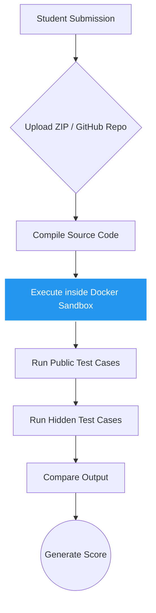
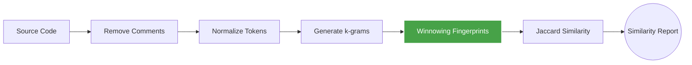

<div align="center">
  
  
  
  
  
  <br />
  <br />
  <h1>🎓 Automated Student Project Evaluation Hub</h1>
  <p>
    <b>A Secure Full Stack Web Platform for Automated Student Project Evaluation, Custom Plagiarism Detection, and Docker-Based Code Execution.</b>
  </p>
</div>

<details>
  <summary>📝 Table of Contents</summary>
  <ol>
    <li><a href="#-overview">Overview</a></li>
    <li><a href="#-features">Features</a></li>
    <li><a href="#-automated-code-evaluation">Automated Code Evaluation</a></li>
    <li><a href="#-custom-plagiarism-detection">Custom Plagiarism Detection</a></li>
    <li><a href="#-user-dashboards">User Dashboards</a></li>
    <li><a href="#-tech-stack">Tech Stack</a></li>
    <li><a href="#-demo-accounts">Demo Accounts</a></li>
    <li><a href="#-getting-started">Getting Started</a></li>
    <li><a href="#-project-structure">Project Structure</a></li>
    <li><a href="#-future-enhancements">Future Enhancements</a></li>
    <li><a href="#-contributing">Contributing</a></li>
    <li><a href="#-license">License</a></li>
  </ol>
</details>

---

## 📖 Overview

The **Automated Student Project Evaluation Hub** is a production-ready web application designed to simplify project submission, automated assessment, plagiarism detection, and secure code execution for educational institutions.

Instead of manually downloading, compiling, and reviewing hundreds of student projects, faculty members can evaluate submissions automatically while students receive instant feedback and detailed reports.

---

## ✨ Features

### 👥 Role-Based Authentication
- ✔️ **JWT Authentication** for secure sessions.
- ✔️ **Password Encryption** using `bcrypt`.
- ✔️ **Role-based Dashboards** for 👑 Admin, 👨‍🏫 Faculty, and 👨‍🎓 Student.

### 📚 Assignment Management
- ➕ **Create Assignments** with rich descriptions, deadlines, and marks allocation.
- 💻 **Multi-language Support:** C, C++, Java, Python, JavaScript.
- 📂 **Submission Methods:** ZIP file uploads & GitHub repository linking.

### 🎨 Modern User Interface
- 📱 **Fully Responsive** design across all devices.
- 💎 **Glassmorphism** aesthetics.
- ✨ **Smooth Animations** powered by Framer Motion.
- 🚀 **Fast Loading** built with React 18 & Vite.

---

## ⚡ Automated Code Evaluation

Every submission goes through a secure evaluation pipeline to ensure accurate and isolated testing.



### 🐳 Docker Sandbox Capabilities
- **Docker Isolation:** Complete separation from the host system.
- **Execution Timeout:** Prevents infinite loops.
- **Resource Limits:** Strict Memory & CPU restrictions.
- **Secure Execution:** Read-only file systems where applicable.

---

## 🕵️ Custom Plagiarism Detection

Unlike projects that rely on third-party APIs, this project includes a fully custom plagiarism detection engine built from the ground up.



### Detection Engine Features
- ✅ **Winnowing Algorithm** for efficient fingerprinting.
- ✅ **Token Normalization** to ignore variable renaming.
- ✅ **Jaccard Similarity** for percentage-based scoring.
- ✅ **Similar Submission Ranking** for easy faculty review.

---

## 📊 User Dashboards

### 👨‍🏫 Faculty Dashboard
- 📈 View submission statistics and analyze class performance.
- 📂 Access and review detailed plagiarism & evaluation reports.
- 📥 Export PDF Reports for offline records.
- 🔔 Receive real-time system notifications.

### 👨‍🎓 Student Dashboard
- 📚 Browse active assignments and deadlines.
- 📤 Upload projects (ZIP/GitHub) seamlessly.
- 🧪 View test results, marks, and detailed evaluation reports.
- 📄 Download generated PDF reports.

### 👑 Admin Dashboard
- 👥 Manage Users, Departments, and Courses.
- 🔐 Control system permissions and access levels.
- 📈 View platform analytics and system health.
- ⚙️ Configure core system settings.

---

## 🏗 Tech Stack

| Category | Technology |
| :--- | :--- |
| **Frontend** | React 18, Vite, Tailwind CSS |
| **Backend** | Node.js, Express.js |
| **Database** | MongoDB + Mongoose |
| **Authentication** | JWT + bcrypt |
| **File Handling** | Multer |
| **Data Visualization** | Chart.js |
| **HTTP Client** | Axios |
| **Animations** | Framer Motion |
| **PDF Generation** | PDFKit |
| **Execution Sandbox** | Docker |
| **Version Control** | Git & GitHub |

---

## 🔐 Demo Accounts

Experience the platform using these test credentials:

| Role | Email | Password |
| :--- | :--- | :--- |
| 👑 **Admin** | `admin@neovika.com` | `Admin@123` |
| 👨‍🏫 **Faculty** | `sarah.j@neovika.com` | `Faculty@123` |
| 👨‍🎓 **Student** | `alex@student.com` | `Student@123` |

---

## 🚀 Getting Started

Follow these steps to set up the project locally.

### 1. Clone Repository
```bash
git clone https://github.com/your-username/project-evaluation.git
cd project-evaluation
```

### 2. Backend Setup
Navigate to the server directory and install dependencies:
```bash
cd server
npm install
```

Create a `.env` file in the `server` directory:
```env
PORT=5000
MONGODB_URI=mongodb://localhost:27017/evaluationhub
JWT_SECRET=your_super_secret_key
JWT_EXPIRE=7d
NODE_ENV=development
```

Start the backend development server:
```bash
npm run dev
```

### 3. Frontend Setup
Open a new terminal, navigate to the client directory, and install dependencies:
```bash
cd client
npm install
npm run dev
```

---

## 📂 Project Structure

<details>
<summary>Click to expand folder structure</summary>

```text
Project Evaluation
│
├── client/                 # React Frontend
│   ├── src/
│   │   ├── assets/         # Images, icons, etc.
│   │   ├── components/     # Reusable UI components
│   │   ├── features/       # Redux slices or context
│   │   ├── hooks/          # Custom React hooks
│   │   ├── layouts/        # Page layouts (Navbar, Sidebar)
│   │   ├── pages/          # Main application pages
│   │   ├── services/       # API call definitions
│   │   ├── styles/         # Global CSS / Tailwind
│   │   └── utils/          # Helper functions
│   ├── public/
│   └── vite.config.js
│
└── server/                 # Node.js Backend
    ├── config/             # DB & Environment configs
    ├── controllers/        # Request handlers
    ├── docker/             # Dockerfile templates & execution scripts
    ├── middleware/         # Auth & Error handling
    ├── models/             # Mongoose schemas
    ├── routes/             # API endpoints
    ├── services/           # Business logic (Evaluation, Plagiarism)
    ├── uploads/            # Temporary storage for submissions
    ├── utils/              # Helper functions
    └── server.js           # Entry point
```
</details>

---

## 📌 Future Enhancements

- [ ] 🤖 **AI-based Code Review**
- [ ] ☁ **Cloud Deployment** (AWS/GCP)
- [ ] 📧 **Email Notifications**
- [ ] 📱 **Mobile Application**
- [ ] 🎥 **Viva Scheduling Integration**
- [ ] 💬 **Real-time Chat Support**
- [ ] 🔗 **GitHub Classroom Integration**
- [ ] 📡 **WebSocket Notifications**

---

## 🤝 Contributing

Contributions are always welcome! Whether it's reporting a bug, discussing improvements, or submitting a pull request.

1. Fork the Project
2. Create your Feature Branch (`git checkout -b feature/AmazingFeature`)
3. Commit your Changes (`git commit -m 'Add some AmazingFeature'`)
4. Push to the Branch (`git push origin feature/AmazingFeature`)
5. Open a Pull Request

---

## ⭐ Support

If you found this project useful or learned something new, please consider giving it a ⭐! 
Fork the repository and contribute to making it even better.

---

## 📜 License

Distributed under the MIT License. See `LICENSE` for more information.

<p align="center">
  <i>Made with ❤️ using React • Node.js • MongoDB • Docker</i>
</p>
